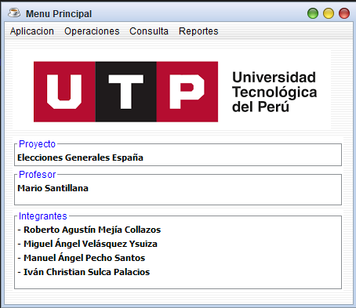

# 
Algoritmos y Estructuras de Datos- Sección 16026

## Docente: Mario Cesar SANTILLANA VALDIVIA

## Proyecto Final
### Menú Principal
()

### Registrar Votos

### Consultar Votos

### Reporte de Votos

### Reporte Nulos de Votos

### Reporte Nulos Abstenidos

### Ganador de Elecciones

